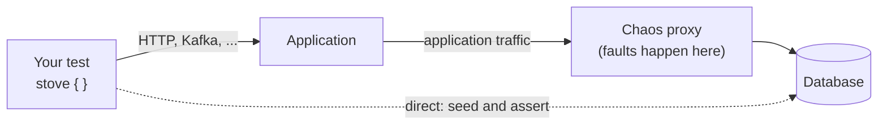
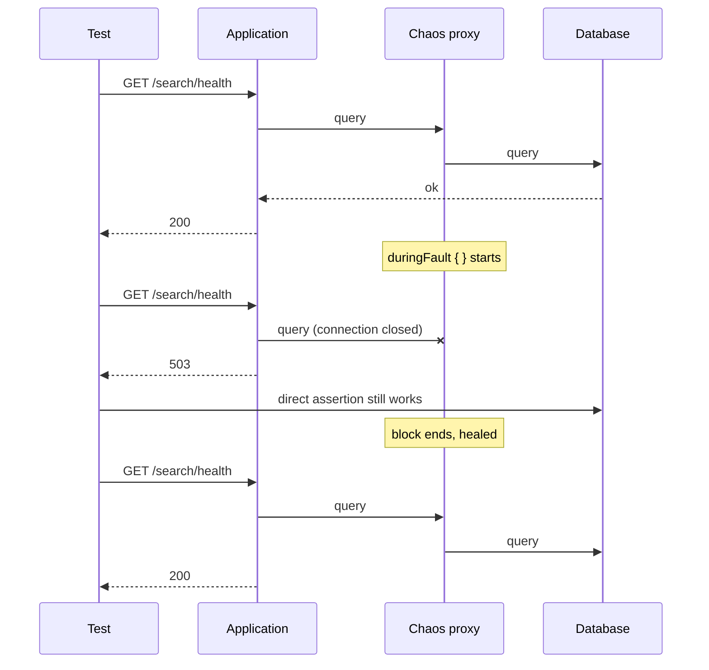
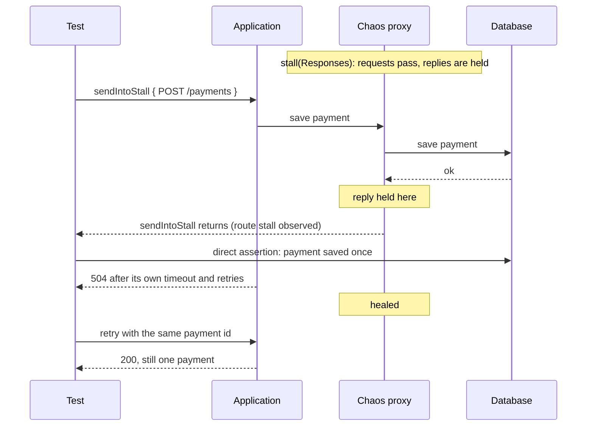
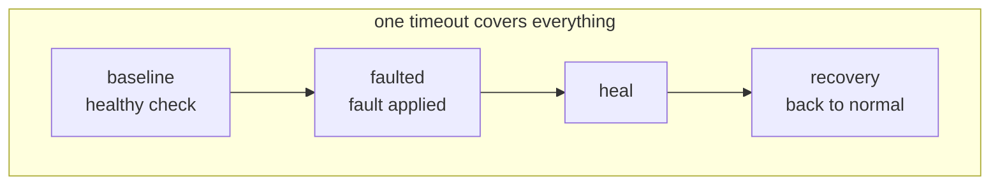

# Chaos Testing

Chaos tests introduce a controlled failure and verify application behavior during the failure and after recovery.
Enable chaos on a database system to route the application's connection through a Stove-managed TCP proxy. The database
stays alive, and Stove keeps its direct connection for migrations, seeding, and assertions.

<div class="stove-tldr" markdown>
<span class="stove-tldr-title">In 30 seconds</span>
Return <code>Options(...).enableChaos()</code> from a supported system's setup block, then call
<code>duringFault { ... }</code> inside that system's validation block. The default fault makes the application's
connection unavailable. Connectivity is restored when the block succeeds, fails, or is cancelled.
</div>

## How it works

With chaos enabled, only the application's connection goes through a proxy. Stove keeps a direct line to the
dependency, so your test can still seed and assert while the application is cut off.



## Which tool for which story

Start from the production incident you want to rehearse, then pick the tool.

| The story | Use | What you prove |
|---|---|---|
| "The database went down during checkout." | `duringFault { }` | The application fails cleanly or falls back, then works again. |
| "The database got slow on a busy day." | `duringFault(latency(800.milliseconds))` | Timeouts and circuit breakers react; callers are not held forever. |
| "The connection hung, with no error at all." | `duringFault(stall())` | The application's own timeouts are bounded. |
| "The payment was saved, but the answer never came back." | `stall(TrafficDirection.Responses)` + `sendIntoStall` | A retry does not charge the customer twice. |
| "A consumer or scheduled job was mid-write when it hung." | `stall()` + `awaitStalledTraffic` | Background work resumes without losing or duplicating data. |
| "I want the report to show healthy, broken, healed." | `chaosExperiment(...)` | All three phases, named, under one deadline. |

### Story 1: the database goes down

Friday evening, the search cluster restarts in the middle of a deploy. Shoppers should see "search is temporarily
unavailable", not a stack trace, and search should work again by itself once the cluster is back. Nobody should have
to restart the application.



```kotlin
elasticsearch {
    duringFault {
        http { getResponse<Map<String, String>>("/search/health") { it.status shouldBe 503 } }
    }
    eventually(10.seconds) {
        stove { http { getResponse<Map<String, String>>("/search/health") { it.status shouldBe 200 } } }
    }
}
```

Details: [Fault the selected system](#fault-the-selected-system-then-verify-recovery).

### Story 2: the database gets slow

Black Friday. The database is alive, but every query takes almost a second longer. Nothing fails, so nothing alerts.
Request threads pile up waiting, and soon the whole site stops answering, including pages that never touch that
database. A slow dependency hurts more than a dead one.

The test adds the delay and proves the application answers quickly anyway: a timeout fires, a fallback or a clear
error comes back, and the caller is not held.

```kotlin
redis {
    duringFault(latency(800.milliseconds)) {
        http { /* GET /products/1, expect the fallback answer well under 800 ms */ }
    }
}
```

### Story 3: the connection hangs without an error

A firewall rule changes and packets are silently dropped. The connection is not closed and no error arrives: there is
only silence. A client without a socket timeout waits forever, and the user watches a spinner.

`stall()` holds the bytes and keeps the connection open. The test proves the application gives up on its own timeout
instead of waiting.

```kotlin
redis {
    duringFault(stall()) {
        http { /* GET /products/1, expect 504 within the configured timeout */ }
    }
}
```

Details: [Choose the fault](#choose-the-fault).

### Story 4: the write landed, the answer was lost

A customer pays. The database saves the payment, but its reply never reaches the application. The application times
out and retries. The customer must be charged once.

The hard part is timing. `sendIntoStall` starts the request, waits for route-wide stall evidence, and hands back a
`Deferred` to await later. Earlier traffic within the current fault or unrelated traffic can satisfy this wait; it does
not identify this request. The diagram shows an isolated request; the direct assertion for its unique payment ID proves
that this payment was saved.



```kotlin
redis {
    duringFault(stall(TrafficDirection.Responses)) { redis ->
        val request = redis.sendIntoStall(2.seconds) {
            http { /* POST /payments with an idempotency key, expect 504 */ }
        }
        // direct assertion: the payment exists exactly once
        request.await()
    }
    // healed: retry the same payment id, assert it is still charged once
}
```

Details and limits: [Observe a response stall](#observe-a-response-stall-before-asserting-its-effect).

### Story 5: a consumer hangs in the middle of its work

An "order created" event arrives. The consumer starts reserving stock, and the database hangs halfway through. The
broker sees no acknowledgement and delivers the event again. The stock must be reserved once, not twice and not zero
times.

Here the test does not send the request: the consumer does, some time after the event is published. So there is
nothing to hand to `sendIntoStall`. `awaitStalledTraffic` waits for route-wide stall evidence without starting work.
It cannot identify the consumer: earlier or unrelated traffic within this fault can satisfy it. Use an isolated fixture
and verify the stock reservation for this order independently after healing.

```kotlin
redis {
    duringFault(stall()) { redis ->
        kafka { /* publish the "order created" event */ }
        redis.awaitStalledTraffic(2.seconds) // route stall observed; verify this order independently
    }
    // healed: the event is processed, assert the stock was reserved exactly once
}
```

### Story 6: the post-incident proof

After an outage, someone asks: "can you prove search survives losing its cluster?" A test that only shows a `503`
during the fault proves little. Maybe search was already broken before the fault, or maybe it never came back after.

`chaosExperiment` answers the whole question in one report: it was healthy, it degraded the way we expect, and it
recovered. The three phases run in order, each one named, all under one deadline.



Details: [Name the baseline, fault and recovery phases](#name-the-baseline-fault-and-recovery-phases).

## Enable chaos where the system is configured

This example configures two Elasticsearch systems. Only `Dc1` is routed through a chaos proxy. The application must use
the endpoint supplied by `configureExposedConfiguration`; an independently configured direct endpoint bypasses the fault.

```kotlin
import com.trendyol.stove.chaos.enableChaos
import com.trendyol.stove.elasticsearch.ElasticsearchSystemOptions
import com.trendyol.stove.elasticsearch.elasticsearch
import com.trendyol.stove.http.HttpClientSystemOptions
import com.trendyol.stove.http.httpClient
import com.trendyol.stove.spring.springBoot
import com.trendyol.stove.system.Stove
import com.trendyol.stove.system.abstractions.SystemKey

object Dc1 : SystemKey
object Dc2 : SystemKey

// Run in your test framework's suite/project startup hook.
Stove().with {
    httpClient { HttpClientSystemOptions(baseUrl = "http://localhost:8080") }

    elasticsearch(Dc1) {
        ElasticsearchSystemOptions(
            configureExposedConfiguration = { cfg ->
                listOf("elasticsearch.dc1.url=http://${cfg.host}:${cfg.port}")
            }
        ).enableChaos()
    }
    elasticsearch(Dc2) {
        ElasticsearchSystemOptions(
            configureExposedConfiguration = { cfg ->
                listOf("elasticsearch.dc2.url=http://${cfg.host}:${cfg.port}")
            }
        )
    }

    springBoot(runner = { params -> Application.run(params) })
}.run()
```

Call `enableChaos()` on the options returned by the setup block. Supported options implement `SupportChaos`;
the extension returns the same concrete instance and chains with `migrations { ... }` in either order.
Setup callbacks remain `() -> Options`, so existing saved factories and function references still work.

The opt-in is read during registration. Configure options before returning them; changing them later does not
reconfigure an existing system. Use separate options for registrations with different settings. Existing cleanup
callbacks and provided-instance options still apply. Without `enableChaos()`, the application receives the direct configuration.

Pair startup with `Stove.stop()` in the framework's teardown hook. Stove owns the proxies: it restores active faults,
stops the application, closes the proxies, and disposes dependencies. No extra proxy singleton or manual `close()` is
needed for managed chaos.

## Fault the selected system, then verify recovery

`duringFault` is scoped to its enclosing system, including its `SystemKey`. Its block exposes the ordinary cross-system
validation DSL, so it can call HTTP, Kafka, or another database while the selected application's connection is faulted.

The following example assumes an application with a JSON `/search/health` endpoint that reports `503` while its primary
search dependency is unavailable and `200` after it reconnects:

```kotlin
import com.trendyol.stove.chaos.duringFault
import com.trendyol.stove.elasticsearch.elasticsearch
import com.trendyol.stove.http.http
import com.trendyol.stove.system.stove
import io.kotest.assertions.nondeterministic.eventually
import io.kotest.matchers.shouldBe
import java.util.UUID
import kotlin.time.Duration.Companion.seconds

val id = UUID.randomUUID().toString()
val index = "chaos-products"
stove {
    elasticsearch(Dc1) { save(id, mapOf("name" to "primary"), index) }
    elasticsearch(Dc2) { save(id, mapOf("name" to "secondary"), index) }
    elasticsearch(Dc1) {
        duringFault {
            http {
                getResponse<Map<String, String>>("/search/health") {
                    it.status shouldBe 503
                }
            }
            elasticsearch(Dc2) {
                shouldGet<Map<String, String>>(index, id) { it["name"] shouldBe "secondary" }
            }
            elasticsearch(Dc1) {
                shouldGet<Map<String, String>>(index, id) { it["name"] shouldBe "primary" }
            }
        }

        // The fault is healed. Keep recovery checks inside this outer system block.
        eventually(10.seconds) {
            stove {
                http {
                    getResponse<Map<String, String>>("/search/health") {
                        it.status shouldBe 200
                    }
                }
            }
        }
    }
}
```

Each block executes once. For asynchronous reconnection, use the test framework's bounded assertion polling or an
appropriate read-only wait helper around the recovery check. Do not retry an entire flow that publishes messages or
creates orders. Keep application connection/request timeouts below the test's assertion window.

The route remains reserved until the enclosing `stove { }` block exits, including checks after `duringFault`.
Another `stove { }` block cannot fault that same route during recovery. Nested faults on the same route are rejected.
Calling `duringFault` without enabling chaos fails with a setup instruction.

Reservations coordinate fault ownership; they do not isolate application traffic. A shared application's pooled
connections and background work can all use the affected route. Run tests sharing that application serially, or use
separate application fixtures.

Container `pause()` freezes the dependency itself, including Stove's direct assertion connection. Use managed
`duringFault` to affect only the application's network route and restore it automatically. Avoid combining container
pause with a network fault: the direct connection can no longer verify state or recovery while the container is paused.

## Name the baseline, fault and recovery phases

Use `chaosExperiment` when the healthy baseline must also be protected from competing fault owners. It reserves the
route before baseline, applies the fault only after baseline succeeds, heals before recovery, and reports each phase
with the experiment name and target. Each phase executes exactly once. Ownership remains until the enclosing
`stove { }` block exits. Nested experiments and standalone `duringFault` calls on the same route are rejected while
an experiment runs, including baseline and recovery. Each phase waits for child coroutines attached to its scope before
advancing; jobs launched in an external scope remain the caller's responsibility.

```kotlin
// Same /search/health contract and imports as above, plus com.trendyol.stove.chaos.*.
stove {
    elasticsearch(Dc1) {
        chaosExperiment(
            name = "Search reconnects after an outage",
            fault = NetworkFault.Unavailable,
            timeout = 15.seconds,
            baseline = {
                http { getResponse<Map<String, String>>("/search/health") { it.status shouldBe 200 } }
            },
            faulted = {
                http { getResponse<Map<String, String>>("/search/health") { it.status shouldBe 503 } }
            },
            recovery = {
                eventually(10.seconds) {
                    http { getResponse<Map<String, String>>("/search/health") { it.status shouldBe 200 } }
                }
            }
        )
    }
}
```

The positive, finite timeout covers all three phases. Cancellation always attempts healing; recovery is skipped when
baseline or the fault phase fails. Coroutine deadlines are cooperative: configure bounded client/socket timeouts too,
and allow restoration to finish even when the experiment deadline expires. Poll only observations, never a whole
create/publish operation. Reservations still do not isolate shared application traffic; use serial tests or dedicated
application fixtures.

### Observe a response stall before asserting its effect

`stall(TrafficDirection.Responses)` allows requests to reach the dependency while holding responses. Inside the active
fault, the system passed to the fault block offers two helpers. `sendIntoStall(2.seconds) { ... }` starts the request
in the background, waits for route-wide stall evidence and returns a `Deferred` to await later. The evidence does not
identify the started request.
`awaitStalledTraffic(2.seconds)` is the wait alone, for traffic started some other way. Both observe the stalled
direction by default (requests when both are stalled); pass `direction` to override.
The observation binds to the fault active when the call begins. It accepts evidence already seen during that fault,
fails on timeout or when the fault ends first, and never consumes evidence from a later fault. Evidence does not prove
that bytes are still buffered when the wait returns, or that they first arrived during this fault. Healing permits
forwarding but does not wait for buffered traffic to drain; a subsequent fault can hold that traffic again. Complete
recovery assertions for the identified operation before starting the next experiment when fresh traffic matters. Observe `Requests` or `Responses` individually, not `Both`.

A stall can buffer one bounded TCP chunk per pump before blocking. This observation establishes transport activity,
not a committed business operation: independently read persisted state using Stove's direct connection. Other traffic
on a shared route can also satisfy the observation, so use a dedicated application/connection and unique operation IDs.

For the HTTP counter fixture, use the same unique operation ID for the request and the direct deduplication assertion:

```kotlin
// Imports: arrow.core.None, com.trendyol.stove.chaos.*, com.trendyol.stove.http.http,
// com.trendyol.stove.redis.redis, com.trendyol.stove.redis.RedisSystem.Companion.client,
// kotlin.time.Duration.Companion.seconds.
// counter and operation are the fixture's unique counter key and operation ID.
stove {
    redis {
        duringFault(stall(TrafficDirection.Responses)) { redis ->
            val request = redis.sendIntoStall(2.seconds) {
                http {
                    postAndExpectBodilessResponse(
                        "/increment", body = None, headers = mapOf("Idempotency-Key" to operation)
                    ) { it.status shouldBe 504 }
                }
            }
            redis.client().connect().use { it.sync().get("$counter:operation:$operation") } shouldBe "1"
            request.await()
        }
    }
}
```

The executable HTTP counter fixture below uses an already authenticated Redis connection, an atomic operation-ID
check plus increment, and two bounded application retry attempts. A response stall produces an HTTP 504 even though
the direct counter is already `1`. After healing, retrying the same operation returns `1`; a fresh operation returns `2`.
This verifies deduplication and fresh application behavior, rather than treating a healed socket as recovery.

## Choose the fault

Pass the fault as the first argument to `duringFault`. Import `stall`, `latency`, and `TrafficDirection` from
`com.trendyol.stove.chaos`, and duration units such as `milliseconds` from `kotlin.time.Duration.Companion`.

| Fault | Behavior |
|---|---|
| `duringFault { ... }` / `NetworkFault.Unavailable` | Closes existing connections and accepts then closes new connections. It does not guarantee a particular TCP error such as reset or refusal. |
| `stall(direction)` | Defaults to `Both`; `Requests` and `Responses` stall only the selected direction. Pauses forwarding without deliberately dropping bytes. TCP backpressure and application timeouts may develop. Healing releases forwarding; timed-out requests may still reach the dependency. |
| `latency(duration, direction)` | Delays each forwarded TCP chunk in `Requests`, `Responses`, or `Both` directions. The default direction is `Both`. This is not a per-request latency guarantee. Healing releases queued chunks. |

Latency must be positive and finite. These faults do not stop the dependency, simulate packet loss, or orchestrate
broker rebalances. A successful write after a timeout is possible; use unique operation IDs when checking retries and
duplicate handling.

## Executable recovery use cases

The repository includes complete fixtures for these scenarios. Their application-facing clients consume the exposed
configuration, while persisted-state checks use Stove's direct connection.

| Scenario | Assertions that establish the outcome | Runnable coverage |
|---|---|---|
| Primary outage while secondary stays usable | An established primary connection and a fresh primary connection fail. A secondary application connection increments a counter during each outage. Direct primary assertions still work. A fresh primary request succeeds after each of three recoveries. | [RedisChaosUseCasesTest](https://github.com/Trendyol/stove/blob/main/lib/stove-redis/src/test/kotlin/com/trendyol/stove/redis/RedisChaosUseCasesTest.kt) |
| HTTP write commits but acknowledgement stalls | Observe held response bytes, independently verify the committed counter, exhaust two bounded AUT retries with HTTP 504, then heal and retry the same operation ID without another increment. A fresh operation succeeds. | [HTTP application](https://github.com/Trendyol/stove/blob/main/lib/stove-redis/src/test/kotlin/com/trendyol/stove/redis/IdempotentCounterApplication.kt), [test](https://github.com/Trendyol/stove/blob/main/lib/stove-redis/src/test/kotlin/com/trendyol/stove/redis/RedisChaosUseCasesTest.kt) |
| Stalled write released after healing | Queue one `INCR`, let a bounded wait expire without cancelling it, and confirm no value exists through the direct connection during the stall. After healing, the same future returns `1`, both clients read `1`, and the fault callback count is one. | [RedisChaosUseCasesTest](https://github.com/Trendyol/stove/blob/main/lib/stove-redis/src/test/kotlin/com/trendyol/stove/redis/RedisChaosUseCasesTest.kt) |
| Application resumes and sees data written during its outage | Save and read a document through Stove during an unavailable fault, then fetch that document through a fresh application-facing HTTP request after healing. | [ElasticsearchChaosTest](https://github.com/Trendyol/stove/blob/main/lib/stove-elasticsearch/src/test/kotlin/com/trendyol/stove/elasticsearch/ElasticsearchChaosTest.kt) |
| Discovery does not escape the supported route | MongoDB uses a real replica set with direct connection enabled; Cassandra verifies its sole discovered endpoint remains the proxy before and after healing. Both check failed application operations and successful direct assertions during the fault. | [MongoDB test](https://github.com/Trendyol/stove/blob/main/lib/stove-mongodb/src/test/kotlin/com/trendyol/stove/mongodb/MongodbChaosAdapterTest.kt), [Cassandra test](https://github.com/Trendyol/stove/blob/main/lib/stove-cassandra/src/test/kotlin/com/trendyol/stove/cassandra/CassandraChaosAdapterTest.kt) |

For example, the stalled-write test keeps the original command future across the fault boundary:

```kotlin
// connection is the application's already connected Redis client; counter is a unique test key.
ValidationDsl(fixture).redis(Primary) {
    lateinit var pending: RedisFuture<Long>
    duringFault(stall()) {
        pending = connection.async().incr(counter)
        shouldThrow<TimeoutException> { pending.get(150, TimeUnit.MILLISECONDS) }
        redis(Primary) {
            client().connect().use { it.sync().get(counter) } shouldBe null
        }
    }
    pending.await() shouldBe 1L
    connection.sync().get(counter) shouldBe "1"
    client().connect().use { it.sync().get(counter) } shouldBe "1"
}
```

The complete linked fixture supplies the imports, timeouts, keys, lifecycle, and callback-count assertion. Here the
bounded wait expires; the command's own timeout does not. This deliberately demonstrates delayed completion without
reissuing a write. If your application retries a command after a timeout, separately assert its operation-ID or
idempotency policy; connectivity restoration alone cannot establish duplicate safety.

The two Redis routes intentionally share a server to prove route selection. Their different keys do not create separate
data stores or isolate shared application background work.

## Supported systems and routing limits

| System | Application configuration to use | Scope |
|---|---|---|
| Elasticsearch | Exposed `host` and `port` | A single HTTP(S) endpoint. Disable client sniffing or other alternate endpoint discovery that would bypass the proxy. |
| PostgreSQL | Exposed `jdbcUrl`, or its exposed `host` and `port` | Standard single-server PostgreSQL JDBC URL. |
| MySQL | Exposed `jdbcUrl`, or its exposed `host` and `port` | Standard single-server MySQL JDBC URL; load-balancing/replication URLs are rejected. |
| SQL Server | Exposed `jdbcUrl`, or its exposed `host` and `port` | Standard single-server SQL Server JDBC URL; named instances and failover overrides are rejected. |
| Redis | Exposed `redisUri`, plus `database` and `password` as required by the application client | Standalone `redis://` or `rediss://`; do not assume the URI includes the selected database or password. Sentinel and cluster discovery are not routed by this adapter. |
| MongoDB | Exposed `connectionString` / `replicaSetUrl` | A single seed with `directConnection=true`; SRV, multiple seeds, load-balanced mode, and TLS are rejected. Preserve the exposed URI instead of rebuilding it from host and port. |
| Cassandra | Exposed contact-point `host` and `port` | A dedicated fixed single-node container using the Java driver 4.x. Provided instances and discovered peers are rejected. No alternative seeds, topology changes, or custom discovery; other language drivers are not covered. |

The JDBC adapters preserve database names, query/properties, and separate credential fields. Unsupported alternate
socket factories and endpoint overrides fail early rather than silently escaping the proxy. Provided JDBC URLs must
match their separately supplied host and port.

Couchbase does not expose managed chaos here. Its driver discovers additional node/service endpoints; rewriting only
the bootstrap endpoint would give incomplete fault coverage. Kafka, other systems,
and application runners also do not gain `enableChaos()` from these database adapters.

The proxy listens on the test host's loopback interface. Host/JVM application runners can consume this endpoint.
Containerized or remote applications cannot reach it merely because chaos was enabled; they need an explicitly reachable
proxy topology. Do not copy this setup into `containerApp` or `providedApplication` tests and assume routing is automatic.

Except for the MongoDB restriction above, TCP forwarding preserves TLS bytes and supplied credentials/certificates.
The application's hostname verification must remain valid for the proxy hostname; Stove does not disable verification
or issue a new certificate. Provided infrastructure remains running, and its existing migration/cleanup policy is
unchanged.

## Read the evidence accurately

Reports identify the selected system/key, applied fault, and connectivity restoration. Restoration means forwarding is
available again. It does not prove the application reconnected, drained its backlog, or avoided duplicate writes.

Assert those outcomes explicitly. A fresh operation that depends on the restored route is stronger evidence of recovery
than finding a document that a healthy replica may already have copied. Use direct database assertions for persisted
state and application requests or traces when the claim concerns routing, retries, or failback.

If fault restoration itself fails, the original experiment error remains primary with restoration failures attached.
A route whose restoration is uncertain cannot be used for another fault; recreate the fixture.

## Existing low-level proxies

`TcpChaosProxy`, `NetworkPartitionTarget`, and `withNetworkPartition` remain available for explicitly managed topologies
and custom controllers. Their lifecycle remains the caller's responsibility:

```kotlin
withNetworkPartition(proxy) {
    // Application-to-dependency connection is unavailable in this block.
}
```

The helper partitions each distinct target in argument order and attempts to restore every attempted target in reverse
order, including the target whose activation partially failed, and also on failure or cancellation. For manually routed proxies, keep Stove on the direct endpoint and close
proxies after `Stove.stop()`. Avoid wrapping an already managed route in another proxy.

See the [setup and chaos migration notes](release-notes/unreleased.md) when upgrading existing setup helpers.
