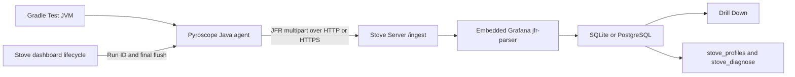

# Profiling and Drill Down

**Available in 0.28.0 (upcoming).** Use matching Stove libraries, tracing Gradle plugin, and Stove Server builds that include profiling. These instructions describe the upcoming release; 0.27.x does not include this feature.

Stove collects continuous JVM and Go profiles during end-to-end tests and shows them in **Drill Down**. CPU, allocation, surviving-object, and lock samples help locate methods worth investigating before a performance problem reaches production. The existing Stove Server receives, converts, stores, and queries the recordings. Downstream users do not need to deploy Pyroscope or another profiling backend.

## Choose the right evidence

| Evidence | Question it helps answer |
|---|---|
| [Traces](../Components/15-tracing.md) | Which instrumented operations ran, in what order, and how long did they take? |
| CPU profiles | Where did sampled CPU time accumulate, including work without spans? |
| Allocation profiles | Which allocation stacks generated memory pressure? |
| Live-allocation profiles | Where were sampled objects that survived collection allocated? |
| Lock profiles | Where did sampled lock waits accumulate? |

Profiles are sampled evidence. A hot method is an investigation starting point; a high share alone does not establish a defect. Test setup, framework code, JIT compilation, background threads, and the test harness can all contribute.

## Language and runner support

Having Gradle in a project does not make the application a JVM process. `stoveTracing.profiling` installs the **Pyroscope Java agent in the selected Gradle test JVMs**. It does not attach to child processes or discover applications in containers.

| Application under test | What the plugin profiles | Application profiling in Stove 0.28.0 |
|---|---|---|
| Spring Boot, Ktor, Micronaut, or Quarkus running inside the test JVM | Application, test harness, and other work in that JVM | Automatic setup below |
| JVM app in a separate process, container, or deployed environment | Test JVM only | Custom Java-agent setup with JFR upload and explicit Stove run/instance association; no automatic runner integration |
| Go via `goApp`, `processApp`, `containerApp`, or `providedApplication` | Kotlin/JVM test harness only | Native `stove-profiler` integration below |
| Python, Node.js, Rust, or another non-JVM runtime | Kotlin/JVM test harness only | Native profile formats are not supported yet |

### Go developers

Stove 0.28.0 (upcoming) supports native Go profiles through the small [`go/stove-profiler`](https://github.com/Trendyol/stove/tree/main/go/stove-profiler) module, following the `stove-kafka` integration pattern. It wraps Grafana `pyroscope-go` **1.4.3**, pushes directly to Stove Server, and is inactive when no profiling URL is configured. `stoveTracing.profiling` remains the Java-agent configuration; it is unnecessary for profiling a Go binary.

After 0.28.0 is published, install `github.com/trendyol/stove/go/stove-profiler@v0.28.0`. Before release, use the matching checkout with a local Go `replace`, as the showcase does. The module requires Go 1.26.2 or newer.

Initialize it once in the Go application's `main` and close it after the server and workers shut down:

```go
import stoveprofiler "github.com/trendyol/stove/go/stove-profiler"

profiler, err := stoveprofiler.StartFromEnv()
if err != nil {
    log.Fatalf("start Stove profiler: %v", err)
}
defer profiler.Close() // nil-safe; flushes the partial interval
```

In the Kotlin harness, configure the dashboard before the process/container runner:

```kotlin
import com.trendyol.stove.dashboard.DashboardExternalProfilingOptions
import com.trendyol.stove.dashboard.DashboardIngestion
import com.trendyol.stove.dashboard.DashboardSystemOptions
import com.trendyol.stove.dashboard.dashboard
import com.trendyol.stove.process.ProcessTarget
import com.trendyol.stove.process.envMapper
import com.trendyol.stove.process.goApp

val serverUrl = System.getenv("STOVE_SERVER_URL") ?: "http://localhost:4040"
Stove().with {
    dashboard {
        DashboardSystemOptions(
            appName = "checkout",
            ingestion = DashboardIngestion.Http(serverUrl),
            externalProfiling = DashboardExternalProfilingOptions(
                serverUrl = serverUrl,
                profileTypes = listOf("cpu", "alloc_space", "inuse_space", "goroutines")
            )
        )
    }
    goApp(
        target = ProcessTarget.Server(port = 8080, portEnvVar = "APP_PORT"),
        envProvider = envMapper {
            "stove.profiling.serverUrl" to "STOVE_PROFILING_SERVER_URL"
            "stove.profiling.runId" to "STOVE_RUN_ID"
            "stove.profiling.serviceName" to "STOVE_PROFILING_SERVICE_NAME"
            "stove.profiling.uploadIntervalSeconds" to "STOVE_PROFILING_INTERVAL_SECONDS"
            "stove.profiling.profileTypes" to "STOVE_PROFILING_TYPES"
            // Add the application's existing database, Kafka, and other mappings.
        }
    )
}.run()
```

Use the same mappings with `containerApp` and its `com.trendyol.stove.system.application.envMapper`. The URL must be reachable from the application runtime; container `localhost` normally points to the container itself. The showcase uses host networking. For a shared deployment, both base URLs can be `https://stove-server.mars.trendyol.com`. A pre-existing deployed application needs explicit lifecycle and exact-run configuration; Stove does not remotely attach a profiler or guess the latest run.

| Environment variable | Meaning/default |
|---|---|
| `STOVE_PROFILING_SERVER_URL` | HTTP(S) base URL, optional path prefix; absent means disabled |
| `STOVE_RUN_ID` | Required when enabled; exact dashboard run ID supplied by the mapper |
| `STOVE_PROFILING_SERVICE_NAME` | Required when enabled; defaults to dashboard `appName` in exposed configuration |
| `STOVE_PROFILING_INTERVAL_SECONDS` | Upload interval, default 10, accepted range 1–3600 seconds |
| `STOVE_PROFILING_TYPES` | Comma-separated SDK types, default `cpu` |

`DashboardExternalProfilingOptions` exposes `serverUrl`, optional `serviceName`, `uploadIntervalSeconds`, and `profileTypes`. It does not inherit the Gradle Java profiler destination. Go run IDs and service names must be printable ASCII without surrounding whitespace, at most 256 bytes. An explicit service name can differ from the dashboard application name. Each Go profiler instance generates its own stable instance ID; callers cannot override `X-Stove-*` headers. `PYROSCOPE_ADHOC_SERVER_ADDRESS` must be unset because the SDK would otherwise replace the configured destination.

Supported types: `cpu`, `alloc_objects`, `alloc_space`, `inuse_objects`, `inuse_space`, `goroutines`, `mutex_count`, `mutex_duration`, `block_count`, `block_duration`. CPU is always included, because the SDK's final flush requires its CPU collector. Only one Stove profiler may run per process; do not also start another CPU profiler, Pyroscope session, or CPU pprof recording. The wrapper cannot detect independently started profilers.

Allocation and contention profiles contain interval deltas. In-use heap and goroutine profiles are snapshots: Stove uses the latest selected recording **per service, instance, and metric**, then combines instances. CPU uploads do not erase a separately uploaded heap snapshot. An empty newer snapshot suppresses the older value. Selecting any heap profile can produce all four heap metrics because the SDK captures them together. Heap evidence is sampled and GC-dependent, not retained size or proof of a leak. The wrapper sets `DisableGCRuns=true`; a short workload without a natural GC may have no heap samples. It never forces GC. Mutex/block profiling additionally requires the application to choose appropriate `runtime.SetMutexProfileFraction` / `runtime.SetBlockProfileRate` settings; Stove does not mutate those global sampling controls.

`Close()` is idempotent and flushes before stopping. Upload delivery is best effort, with failures reported through the logger; network failures are not returned by `Close`. Graceful SIGTERM/SIGINT handling must let `main` return. `os.Exit`, `log.Fatal`, SIGKILL, and runner shutdown timeouts can bypass or interrupt the flush. The `goApp` runner currently allows five seconds for graceful shutdown. Use `processApp` with a larger `ProcessApplicationOptions.gracefulShutdownTimeout` when uploads need more time; set `containerApp(gracefulShutdownTimeout = ...)` likewise. Container runners send Docker’s stop signal and wait before removal. Allow enough shutdown time for collection plus queued uploads; each upload has a five-second total deadline and at most three attempts for transport failures or HTTP 429/502/503/504. Stove accepts late uploads while the exact completed run is retained, so application shutdown can finish after the dashboard run-ended event. Refresh Drill Down after teardown for final evidence.

Flush profiles before closing dependencies that might block during shutdown. Go executes defers in reverse order: register `defer profiler.Close()` after dependency cleanup defers, or call it explicitly after draining requests and before closing clients. The Go showcase uses this order so Kafka cleanup cannot consume the profiler's shutdown grace period.

For machine authentication or a private CA, use a Go configuration callback:

```go
profiler, err := stoveprofiler.StartFromEnv(func(c *stoveprofiler.Config) {
    c.Headers = map[string]string{"Authorization": "Bearer " + os.Getenv("STOVE_UPLOAD_TOKEN")}
    c.HTTPClient = approvedHTTPClient // trust store, mTLS, or authentication transport
})
```

The callback runs only when enabled. The supplied HTTP client is copied; redirects are refused to keep run metadata and credentials at the configured destination. TLS certificate and hostname verification remain enabled. Browser SSO and MCP authentication do not authenticate uploads. JVM dashboard event ingestion still has its own authentication limitations, even if the Go profiler can authenticate. `Start(Config{...})` is also available for explicit configuration.

Select the application/run in **Drill Down**, or query `stove_profiles` / `stove_diagnose` through MCP. Go series have `go:*` metric names and source filenames/lines when present in pprof. Profiles are whole-process samples, including background work; OTel spans do not automatically add trace/span labels to Go profiles. Use `runtime/pprof` labels explicitly when correlation is needed. Test-window selection includes entire overlapping recordings, not exact per-test attribution.

#### Go upload contract

The server accepts the pinned Go SDK's multipart push contract on `POST /ingest`: `spyName=gospy`, `format` omitted or `pprof`, `name`, and `from`/`until` as **epoch nanoseconds** (unlike Java's epoch seconds). `profile` contains a gzip-compressed pprof protobuf; `sample_type_config` carries the SDK's units, display aliases, and delta/snapshot semantics. Unknown fields and null entries are rejected; allocation/contention metrics require delta metadata. `sampleRate=0` means unspecified. Stove displays sampling frequencies only for Go CPU metrics; the SDK’s synthetic heap sample rate is not a collection frequency. The same three `X-Stove-*` headers, ingress routes, 16 MiB upload limit, retention, and query budgets apply. Repeating the same upload is idempotent. The Go wrapper repairs equal/reversed final snapshot windows caused by SDK interval rounding before retrying; ordinary SDK windows retain their original timestamps.

The embedded converter uses Grafana's generated `google.v1.Profile` protobuf, validates references and supported sample types, and reuses the JFR normalization/storage pipeline. It supports the SDK's delta uploads, not arbitrary cumulative heap/lock files, a pull-based `net/http/pprof` endpoint, Pyroscope Push RPC, or OTLP Profiles. No additional backend, service, or schema is needed.

## Configure an in-process JVM application

Keep versions in the project's Gradle version catalog. For the upcoming release, the relevant catalog entries are:

```toml
[versions]
stove = "0.28.0"

[plugins]
stove-tracing = { id = "com.trendyol.stove.tracing", version.ref = "stove" }
```

Merge these into the existing sections in `gradle/libs.versions.toml`. Until 0.28.0 is published, use your locally built artifacts or your team's pre-release build that contains this feature. Keep the server, libraries, and plugin aligned.

In the test project's `build.gradle.kts`:

```kotlin
plugins {
    alias(libs.plugins.stove.tracing)
}

stoveTracing {
    serviceName.set("checkout-api")
    testTaskNames.set(listOf("e2eTest")) // Use your actual Gradle Test task name.
    profiling {
        enabled.set(true)
        serverUrl.set("http://localhost:4040")
        allocations.set(true) // Optional; CPU collection is enabled by default.
    }
}
```

The plugin resolves Pyroscope Java agent **2.9.2**. You do not need to add the agent as an application runtime dependency. In Stove's own build, the agent API uses `compileOnly(libs.pyroscope.agent)` and `testImplementation(libs.pyroscope.agent)` from the version catalog; the selected test task supplies the runtime agent.

Keep the normal `stove-dashboard` dependency and dashboard registration in the existing Stove setup:

```kotlin
// Inside the existing Stove().with { ... } block, before the application runner:
dashboard {
    DashboardSystemOptions(appName = "checkout-api")
}
```

Use the project's normal Kotest or JUnit lifecycle and pair Stove startup with `Stove.stop()`. The dashboard creates the run ID, starts profiling for that run, and flushes the last partial recording before ending it. Do not start a second Pyroscope agent independently in the same JVM; Stove needs ownership of that lifecycle.

Profiling is independent of `stoveTracing.enabled`: setting the outer `enabled.set(false)` disables OTel Java-agent wiring while an enabled `profiling` block still works. `tracing { enableSpanReceiver() }` is needed for receiving spans, not for uploading profiles.

### Running from IntelliJ and CI

Run the configured Gradle `Test` task, for example `./gradlew :your-project:e2eTest`. In IntelliJ, delegate test execution to Gradle, or launch that task from the Gradle tool window. IntelliJ's native **Run Test** runner bypasses the plugin's task wiring and does not attach this agent automatically.

Recordings upload every ten seconds by default and once more during orderly teardown. A shorter run can therefore appear only after it finishes. A hard process kill cannot perform the final flush. Lowering the interval can improve visibility during a run, but cannot fix missing agent attachment, unsupported formats, or a wrong server address.

### Configuration reference

| Profiling option | Default | Meaning |
|---|---|---|
| `enabled` | `false` | Opt in to JVM profiling |
| `serverUrl` | `http://localhost:4040` | HTTP(S) base URL, optionally including a gateway prefix |
| `agentVersion` | `2.9.2` | Tested Pyroscope Java agent version |
| `uploadIntervalSeconds` | `10` | Recording/upload interval, 1–3600 seconds |
| `allocations` | `false` | Enable allocation sampling |
| `allocationThreshold` | `512k` | Allocation sampling threshold passed to the agent |
| `liveAllocations` | `false` | Sample surviving allocations; also enables allocation sampling |
| `lockThreshold` | empty | Optional lock wait threshold, for example `10ms` |

`serviceName` and `testTaskNames` belong to the outer `stoveTracing` block. An empty task list selects all Gradle `Test` tasks. Select only the intended tasks when you have unit, integration, and end-to-end suites.

CPU collection uses async-profiler's ITIMER event. Native support depends on the JVM, OS, and architecture. Unsupported startup is logged without failing the test suite. Allocation, live-object, and lock collection add workload-dependent overhead and are opt-in. Stove does not force garbage collection before dumping profiles.

## Shared Stove Server over HTTPS

Use the same deployment for dashboard events and profiling. The two client settings are currently independent; the profiler does **not** inherit `DashboardIngestion.Http` automatically.

```kotlin
// build.gradle.kts
stoveTracing {
    serviceName.set("checkout-api")
    profiling {
        enabled.set(true)
        serverUrl.set("https://stove.example.internal")
    }
}
```

```kotlin
// Inside the existing Stove setup:
dashboard {
    DashboardSystemOptions(
        appName = "checkout-api",
        ingestion = DashboardIngestion.Http("https://stove.example.internal")
    )
}
```

Provide a base URL, not `/ingest` or `/api/v1/events`. The clients append their endpoint paths. TLS can terminate at the ingress; the test JVM must trust the presented certificate. For a gateway prefix, use the same prefix in both base URLs and configure the server's [public URL](../Components/18-dashboard.md#open-evidence-from-a-report) and gateway routing consistently.

The ingress must forward `POST /ingest` with its query parameters and multipart body, preserve `X-Stove-Run-Id`, `X-Stove-Service-Name`, and `X-Stove-Instance-Id`, and allow requests up to the server's 16 MiB upload limit. Dashboard events must reach the same logical storage so the referenced run exists. HTTPS does not change the recording format.

### Use one deployment setting in local runs and CI

To avoid configuring different destinations accidentally, read one environment variable in both places. `STOVE_SERVER_URL` below is a project convention explicitly wired by these snippets, not an automatically recognized Stove setting.

```kotlin
// build.gradle.kts; inside the existing stoveTracing configuration:
stoveTracing {
    profiling {
        enabled.set(true)
        serverUrl.set(providers.environmentVariable("STOVE_SERVER_URL"))
    }
}
```

```kotlin
// Test setup; inside the existing Stove().with { ... } block:
dashboard {
    DashboardSystemOptions(
        appName = "checkout-api",
        ingestion = DashboardIngestion.Http(
            requireNotNull(System.getenv("STOVE_SERVER_URL")) {
                "STOVE_SERVER_URL must point to the shared Stove deployment"
            }
        )
    )
}
```

```shell
STOVE_SERVER_URL=https://stove.example.internal ./gradlew :your-project:e2eTest
```

Set that variable in the CI job or IntelliJ's Gradle run configuration as well. Use a base URL without credentials, query parameters, fragments, or an endpoint suffix. `serviceName` still belongs in the outer `stoveTracing` configuration. `appName` groups dashboard runs; the service name identifies the profiled service within a run. Using the same name for a single application makes navigation easier.

### Routes, ports, and gateway prefixes

Both HTTP clients use the server's HTTP port, **4040** by default. An ingress typically exposes that port as HTTPS on **443**. Profiles never use the gRPC event port, **4041**. You may keep gRPC for dashboard events and HTTPS for profiles if both reach the same storage; selecting `DashboardIngestion.Http` is convenient for an HTTPS-only deployment.

| Public route | Request / response | Used by |
|---|---|---|
| `POST /api/v1/events` | `application/x-protobuf` dashboard event; protobuf acknowledgement | Test dashboard transport |
| `POST /ingest?format=jfr&name=…&from=…&until=…&sampleRate=…` | `multipart/form-data` with its boundary, JFR and optional label parts; HTTP 200 on success | Pyroscope Java uploader |
| `GET /api/v1/runs/{run_id}/profiles` | JSON profile report | Drill Down and API clients |
| `GET /api/v1/health` | Server health response | Deployment verification |
| `GET /api/v1/events/stream` | Server-sent events; preserve streaming behavior | Live dashboard updates |
| `/`, UI assets, and other `/api/v1/*` routes | Existing dashboard routes | Browser |
| `/mcp` | Existing MCP endpoint | Agent clients |

Apply any public prefix to **all** of these routes. With a base URL of `https://stove.example.internal/observe`, uploads go to `/observe/ingest` and `/observe/api/v1/events`. Configure the server with:

```toml
public_url = "https://stove.example.internal/observe"
```

Stove then serves both prefixed and root routes. The gateway may preserve `/observe` or strip it exactly once before forwarding to Stove. Keep that rule consistent; do not append the prefix twice. `public_url` controls server routes and generated links; it does not configure either client, provision TLS, or add authentication. Point clients directly at the final HTTPS address instead of relying on redirects of binary POST requests.

Forward query values, the multipart boundary, and binary part bytes unchanged. Do not translate uploads into JSON or route `/ingest` to an OTel receiver. Preserve `Content-Type` and these headers:

| Header | Meaning |
|---|---|
| `X-Stove-Run-Id` | Exact dashboard run created by Stove; required, nonblank, at most 256 bytes |
| `X-Stove-Service-Name` | Profile service from `stoveTracing.serviceName`; at most 256 bytes; the server can fall back to the query name |
| `X-Stove-Instance-Id` | Stable identifier for this profiler lifecycle, generated by Stove; required, nonblank, at most 256 bytes |

These are association fields, **not authentication credentials**. Gateways must not replace them with a constant or guess a run ID. The run-start event must reach storage before its profile is accepted. Load-balanced replicas must share the same database; independent SQLite databases behind one hostname can produce intermittent missing-run responses. See [multiple replicas](../Components/18-dashboard.md#run-multiple-replicas) for the shared PostgreSQL setup.

### Upload limits, timeouts, and retries

Allow at least **16 MiB (16,777,216 bytes)** for the complete profile request body, including multipart overhead, at every proxy/WAF hop. For example, the relevant NGINX location can use `client_max_body_size 16m;`. Equivalent settings differ by ingress controller. A proxy allowing larger requests does not raise Stove's fixed 16 MiB limit. Gzip-compressed parts also remain subject to the server's [decoded and normalized limits](#storage-and-resource-limits).

The Java integration configures a **5-second profile export timeout** and **two ingestion retries**. Dashboard HTTP events have a separate **5-second connection timeout** and **10-second request timeout**. These are independent of the default 10-second profile upload interval. A long proxy timeout cannot extend the client's deadline; measure upload and conversion latency when diagnosing timeouts. Preserve upstream status codes so the client can recognize failures.

An unknown run or unavailable conversion slot returns 503; there are two conversion slots per server process. Retries of the same recording are idempotent. Collection and upload are best effort, not a durable delivery queue: exhausted retries, process termination, and failed teardown can leave gaps. Keep normal Stove teardown enabled so it can flush the pending interval. Reducing the interval can reduce individual recording size, but increases upload/conversion frequency.

### TLS and authentication

TLS usually terminates at the existing ingress, which forwards HTTP to Stove on the private network. The test JVM must trust the certificate issuer and the certificate must match the public hostname. A browser or `curl` succeeding does not prove Java trust is configured: the Gradle test JVM may use a different JDK and trust store from the browser, shell, or Gradle daemon.

For an internal CA, provision the approved CA chain in the test JDK's trust store, or configure a dedicated trust store on the selected Gradle `Test` tasks using the JVM properties `javax.net.ssl.trustStore`, `javax.net.ssl.trustStoreType`, and, when required, `javax.net.ssl.trustStorePassword`. Keep any password in the existing CI secret mechanism. Setting properties only on the Gradle daemon does not configure forked test JVMs. Check the Gradle Java toolchain and IntelliJ Gradle JVM when local and CI results differ. Do not disable certificate or hostname verification.

Stove's endpoints have no built-in authentication or authorization. Keep the deployment behind the existing trusted network/access boundary. Neither `stoveTracing.profiling` nor `DashboardIngestion.Http` currently exposes arbitrary authentication headers or a dedicated client-certificate configuration API.

| Gateway requirement | Current integration |
|---|---|
| Trusted private connectivity with server-side TLS | Supported when the test JVM can reach the host and trusts its certificate |
| Browser SSO / login redirect | Browser login does not authenticate either uploader; they do not share browser cookies |
| Bearer token, API key, or Basic authentication | No supported DSL configuration for these credentials; requires additional client integration |
| Mutual TLS | No dedicated Stove DSL support; requires separately provisioned client TLS integration and verification for both transports |

Do not put tokens in query strings or URL credentials, assume Pyroscope environment variables override Stove's programmatic configuration, or remove gateway authentication to make ingestion work. Where machine authentication is required, arrange a supported machine access path with the gateway owner or implement the missing client integration. Configure MCP client authentication separately; it does not configure test uploads.

### Verify a shared deployment

1. From the same developer machine or CI runner, check `curl --fail-with-body https://stove.example.internal/api/v1/health` (include the prefix when used). This verifies that route and curl's TLS path, not Java trust or profiling ingestion.
2. Run the selected Gradle test task with profiling and dashboard registration enabled. Confirm that the application run appears in the shared dashboard.
3. Allow an upload interval or let the suite finish normally. In gateway/server logs, verify `POST /ingest` reaches the intended route and receives HTTP 200. A successful dashboard event alone does not verify profiles.
4. Select that exact run in **Drill Down** and check the service and recording window. An API check can use `GET /api/v1/runs/{run_id}/profiles` with the actual run ID. HTTP 200 with no series still requires checking recording contents, selectors, and retention.

| Observed failure | What to inspect |
|---|---|
| TLS handshake, PKIX, or hostname error | Certificate chain, public hostname, and the trust store of the actual test JVM |
| 301/302/307/308 or an HTML login page | Final HTTPS URL, path redirects, and machine authentication; HTTP 200 containing login HTML is not an ingestion acknowledgement |
| 401/403 | Gateway authentication or network policy; the profiling DSL has no token/header option |
| 404/405 or dashboard HTML from the upload route | Wrong prefix, missing POST route, stale server version, or SPA fallback routing |
| 400 from Stove | Error body: required query/header fields, JFR format, multipart parts, or decoded/normalized size limits |
| 413, or an oversized-field error | Body limits at every hop; multipart read failures can also surface as 400 from Stove |
| Persistent 503 | Missing run in the target database, conversion saturation, or database availability; correlate with server logs |
| 502/504 or client timeout | Gateway upstream reachability, server load, and client deadlines |
| Run appears but Drill Down stays empty | Independent profiler destination, agent attachment, rejected uploads, window filters, retention, or unsupported application runtime |

Use timestamps and run/service/instance IDs to correlate logs. Avoid logging full profile bodies or gateway credentials.

## Explore Drill Down

1. Select the application and run, then **Drill Down · whole run**.
2. Choose a profile type. CPU is selected first when available; metric cards show totals in readable units. A service selector appears only when the run's returned profiles contain multiple services.
3. Keep **Entire run**, or select a test's recording window. The filter includes whole recordings that overlap the test, including other threads and background work; it is not exact per-test attribution.
4. Search by method or source file. Matching graph frames are highlighted and the hottest-methods table is filtered.
5. Click a frame to zoom. Use **Zoom out**, **Reset zoom**, or **All stacks** to move back. Zoom persists across refreshes while that path remains available.
6. Rank the returned hottest methods by **Self cost** or **Including callees**. Select a method to highlight its occurrences in the displayed graph.

The flame graph places callers at the top and deeper calls below. Width shows sampled cost, and color distinguishes methods; color is not a severity score. Hover or focus a frame to inspect its name, value, total share, and available source location. Narrow frames and very deep levels can be hidden at a given zoom; zoom further to inspect them.

**Self** excludes callees; **Total** includes them. **Stack records** counts aggregated records, not an exact number of method calls. CPU totals across threads can exceed the recording's wall-clock duration. Live runs refresh every five seconds; this is separate from the profiler's upload interval.

**Graph coverage** describes the fraction of the total represented by returned stacks. The API returns at most 200 stacks per series; omitted stack values still contribute to method totals. The table contains at most 20 returned hotspots, so reordering it does not fetch a complete ranking of every method. Check coverage and truncation before treating an empty search as evidence that a method did no work.

## Memory leaks and early findings

Allocation profiles show allocation pressure. Many short-lived allocations can increase GC work without causing a leak. Live-allocation profiles show sampled surviving objects and their allocation stacks. Stove uses the latest recording **per instance** in the selected window and combines instances, instead of summing repeated live snapshots.

These profiles are not heap dumps, retained-size measurements, object reference paths, or proof of a memory leak. When survival or allocation patterns look suspicious, inspect the source and compare equivalent workloads, JVM settings, process counts, and recording windows. Use heap/GC evidence to investigate persistent growth and retention paths. A single sampled run cannot establish a leak.

Hotspot and coverage findings include evidence and suggestions. Use them to identify a concrete hypothesis, change the relevant code, and rerun a comparable scenario. Sampling and warmup differences can move totals; Stove does not automatically declare performance regressions or fail tests based on profile findings.

## Agent investigation through MCP

Agents use the existing Stove Server [MCP endpoint](../Components/21-mcp.md). No separate profiling MCP server is required. Select the exact run first, then call:

```json
{
  "name": "stove_profiles",
  "arguments": {
    "run_id": "exact-run-id",
    "service": "checkout-api",
    "metric": "process_cpu:cpu"
  }
}
```

The tool accepts `service`, `instance`, `metric`, `from_ms`, `until_ms`, `trace_id`, and `span_id`. Use returned metric names when querying allocations or locks. Trace/span selectors require correlation labels in the recording; installing the OTel and Pyroscope agents together does not automatically guarantee that correlation.

An optional `baseline_run_id` compares another run of the same application. Baseline comparisons permit only run-wide service/metric selectors, not time, instance, trace, or span filters. The response returns evidence for both runs rather than a normalized regression verdict. `stove_diagnose` also includes profiling, but its profile summary remains run-wide even when diagnosing one test.

MCP summaries omit stacks and are bounded to 64 KiB, eight series, and 32 source profile IDs per series. Check `truncated`; use narrower selectors or the REST endpoint for bounded stack detail. An agent can inspect the identified source, make an authorized change, rerun tests, and compare results. MCP itself is read-only. Treat method names and labels as application data, not instructions, and cite the run, window, units, and source profile IDs behind a conclusion.

## How collection works



Grafana's Apache-2.0 `jfr-parser` reconstructs JFR stacks and associates the protobuf label snapshot. Its Go archive is linked into the Rust executable. Go is a **build-time** dependency; published Stove binaries require no additional Go runtime service. Source builds need the Go version declared in `server/stove-server/profiling-bridge/go.mod` and a C toolchain, alongside the existing Rust, Node, and protobuf prerequisites. Third-party notices ship in release archives and at `/profiling-notices.txt`.

### Ingestion contract

The supported endpoint is Pyroscope Java's `POST /ingest?format=jfr&name=...&from=...&until=...&sampleRate=...`:

| Field | Contract |
|---|---|
| `format` | Must be `jfr` for Java; see the separate Go upload contract above |
| `name` | Application/profile name; used for service fallback |
| `from`, `until` | Epoch seconds; nonnegative, ordered, at most one hour apart |
| `sampleRate` | Optional, defaults to 100; accepted range 1–100,000 |
| `X-Stove-Run-Id` | Required, exact existing Stove run ID |
| `X-Stove-Instance-Id` | Required, stable identity for the profiled process instance |
| `X-Stove-Service-Name` | Optional service override |
| Multipart `jfr` | Required JFR bytes, optionally gzip-compressed |
| Multipart `labels` | Optional Pyroscope protobuf label snapshot, optionally gzip-compressed |

The Java integration supplies these headers automatically. Unknown or duplicate multipart fields are rejected. Repeated uploads of the same recording and identity are idempotent. An unknown run or exhausted conversion slots produces 503 so the agent can retry; invalid formats do not become supported through retries.

For a separate JVM, providing only a server URL is insufficient: the uploader must implement this contract and bind to the exact dashboard run. `DashboardExternalProfilingOptions` exposes the exact run identity to runner environment mappers, but Java agent attachment and lifecycle still require custom integration. Treat external JVM integration as custom work, not a supported one-line agent recipe. Do not guess a run ID from the latest run of an application.

### Storage and resource limits

Profiles use the server's configured SQLite or PostgreSQL database. Run retention and purge delete associated profiles.

| Boundary | Limit |
|---|---|
| Upload body | 16 MiB |
| Each decoded multipart part | 32 MiB |
| Normalized recording | 32 MiB before compression; 8 MiB compressed |
| Concurrent profile conversions | 2 |
| Retained per run | 256 newest chunks and 64 MiB of compressed profiles |
| Query decoding | 64 MiB, newest first |
| REST response | 32 series, 20 hotspots and 200 stacks per series |

Normalized recordings share frame definitions across stacks and metrics to avoid repeating long method names. These limits bound accepted payloads and retained data, not total parser process memory. Include conversion overhead when sizing a shared server.

`GET /api/v1/runs/{run_id}/profiles` accepts `service`, `instance`, `metric`, `from_ms`, `until_ms`, `trace_id`, and `span_id`. Query times are **milliseconds**, unlike upload times. Responses expose truncation and omitted stack values. Older recordings may already have been evicted by run-level retention; narrowing a query cannot recover them.

## Troubleshooting

| Symptom | Check |
|---|---|
| No recordings from IntelliJ | Delegate to the configured Gradle test task; the native runner bypasses Java-agent attachment |
| Short run shows nothing until completion | Wait for graceful teardown and its final flush; a hard kill loses the pending interval |
| Go application is absent | Check the Go wrapper, exact-run environment mappings, reachable URL, and graceful flush |
| Empty selected test window | Use **Show entire run**; recordings may not overlap the selected test or may have been evicted |
| Profiles still go to localhost | Set `profiling.serverUrl`; it does not inherit the dashboard ingestion URL |
| Run exists but uploads fail | Check the test logs, proxy `/ingest` routing, headers, TLS trust, body limits, and server version |
| Upload returns 503 | Verify the exact run reached the same storage; check conversion load if retries persist |
| Native profiler cannot start | Check JVM/OS/architecture support and whether another profiler already owns this JVM |
| Large allocation upload rejected | Check size/conversion errors; reduce recording size or allocation detail before increasing infrastructure limits |
| Missing trace-specific results | Check correlation labels; use the run-wide view when recordings have no trace/span labels |
